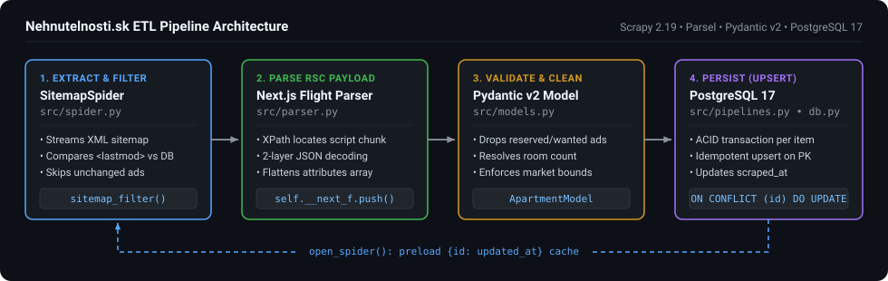
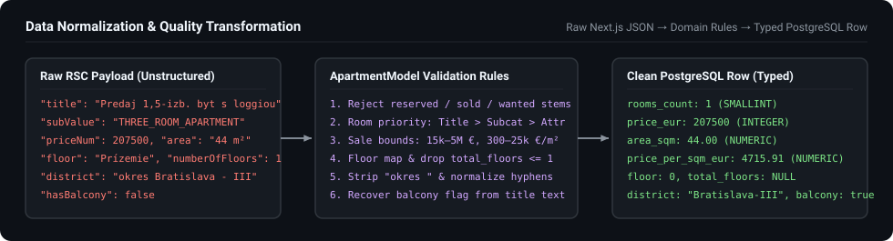

# nehnutelnosti.sk ETL Pipeline

Incremental ETL pipeline for scraping apartment sale listings from `nehnutelnosti.sk` into PostgreSQL 17 using Scrapy, Parsel, and Pydantic v2.



## Pipeline Stages

### 1. Sitemap Filtering (`src/spider.py`)
* `ApartmentSitemapSpider` reads `sitemap-listings-byty-predaj-slovensko.xml`.
* On startup, `PostgresPipeline.open_spider()` loads existing `{id: updated_at}` records from PostgreSQL into `spider.existing_timestamps`.
* `sitemap_filter()` compares each `<url>` entry's `<lastmod>` timestamp against `existing_timestamps` and skips listings that have not changed since the last crawl.

### 2. Next.js RSC Payload Parsing (`src/parser.py`)
Listing pages use the Next.js App Router and embed structured listing data inside a React Server Components (RSC) Flight `<script>` tag:
1. `find_ad_script()` selects the `<script>` node containing `self.__next_f.push(` and `\"advertisement\":{\"id\"` via XPath.
2. `extract_ad_dict()` strips the `self.__next_f.push(` call wrapper and runs `json.loads()` to decode the raw Flight stream string.
3. The line containing `{"advertisement":{"id"` is isolated, stripped of its hex chunk prefix (`<id>:`), and parsed as JSON (`data[3]["advertisement"]`).

### 3. Validation & Normalization (`src/models.py`)
Extracted dictionaries are validated and normalized by `ApartmentModel` before database insertion:



| Rule | Raw Input Example | Output | Implementation |
| :--- | :--- | :--- | :--- |
| **Inactive / Wanted Ads** | `"REZERVOVANÉ: 2i byt..."` | Dropped (`DropItem`) | Rejects reserved, sold, rented, flatshare, and buyer-wanted listings by diacritic-stripped title stems. |
| **Room Count Resolution** | Title: `"1,5-izbový"`, Subcat: `THREE_ROOM` | `rooms_count = 1` | Priority order: **Title** (digits & Slovak numeral stems) $\rightarrow$ **Subcategory** $\rightarrow$ **Raw attribute**. |
| **Price Bounds** | `price_eur = 500`, `area_sqm = 55.0` | `price_eur = NULL` | Enforces sale bounds (`15,000–5,000,000 €` and `300–25,000 €/m²`) and recalculates `price_per_sqm_eur`. |
| **Floor Parsing** | `"Prízemie"` / `"Suterén"` | `0` / `-1` | Maps Slovak floor strings to integers (`-2..46`); sets `total_floors = NULL` when `<= 1` or `< floor`. |
| **Balcony Detection** | `hasBalcony = False`, Title: `"...s loggiou"` | `has_balcony = True` | Checks structured attributes and title keywords while excluding negated forms (`"bez balkóna"`). |
| **District Formatting** | `"okres Bratislava - II"` | `"Bratislava-II"` | Strips `"okres "` prefix and normalizes hyphen spacing. |

### 4. PostgreSQL Upsert (`src/pipelines.py`, `src/db.py`)
Validated records are written to PostgreSQL via `INSERT INTO apartments ... ON CONFLICT (id) DO UPDATE`, updating modified fields and refreshing `scraped_at`.

---

## Database Schema

Defined in [`sql/init_schema.sql`](sql/init_schema.sql):

| Column | Type | Nullable | Description |
| :--- | :--- | :--- | :--- |
| `id` | `VARCHAR(32)` | `PRIMARY KEY` | Listing ID from URL (`Ju...`) |
| `url` | `TEXT` | `NOT NULL` | Listing detail URL |
| `title` | `TEXT` | `NULL` | Listing title |
| `transaction_type` | `VARCHAR(32)` | `NULL` | Normalized transaction type (`predaj`) |
| `category_sub` | `VARCHAR(64)` | `NULL` | Subcategory code (`ONE_ROOM_APARTMENT`, `STUDIO_APARTMENT`, etc.) |
| `rooms_count` | `SMALLINT` | `NULL` | Room count (`1..10`) |
| `price_eur` | `INTEGER` | `NULL` | Total price in EUR (`NULL` if omitted or out of bounds) |
| `price_per_sqm_eur` | `NUMERIC(10, 2)` | `NULL` | Unit price in EUR/$\text{m}^2$ (`ROUND(price_eur / area_sqm, 2)`) |
| `area_sqm` | `NUMERIC(8, 2)` | `NULL` | Floor area in $\text{m}^2$ (`10.0..600.0`) |
| `floor` | `SMALLINT` | `NULL` | Floor number (`-2..46`, `0` = ground floor) |
| `total_floors` | `SMALLINT` | `NULL` | Total floors in building (`> 1` and `>= floor`) |
| `property_condition` | `VARCHAR(64)` | `NULL` | Property condition (`Novostavba`, `Kompletná rekonštrukcia`, etc.) |
| `has_elevator` | `BOOLEAN` | `NOT NULL` | Elevator flag (`DEFAULT FALSE`) |
| `has_balcony` | `BOOLEAN` | `NULL` | Three-valued balcony, loggia, or terrace flag (`TRUE` = confirmed, `FALSE` = negated, `NULL` = unspecified) |
| `city` | `VARCHAR(128)` | `NULL` | City or borough |
| `district` | `VARCHAR(128)` | `NULL` | District name without `"okres "` prefix |
| `updated_at` | `TIMESTAMPTZ` | `NULL` | Source modification timestamp |
| `scraped_at` | `TIMESTAMPTZ` | `NOT NULL` | Last upsert timestamp (`DEFAULT NOW()`) |

---

## Project Structure

```text
data-pipeline/
├── docs/
│   ├── architecture.svg
│   └── data_flow.svg
├── sql/
│   └── init_schema.sql
├── src/
│   ├── parser.py
│   ├── models.py
│   ├── db.py
│   ├── pipelines.py
│   └── spider.py
├── .dockerignore
├── .env.example
├── Dockerfile
├── docker-compose.yml
└── requirements.txt
```

---

## Usage

### 1. Environment Variables
```bash
cp .env.example .env
```

```ini
DB_HOST=127.0.0.1
DB_PORT=5432
DB_NAME=nehnutelnosti
DB_USER=scraper
DB_PASSWORD=your_password
DB_SSLMODE=disable
```

### 2. Docker Compose
Starts `postgres:17` and runs the scraper container:

```bash
docker compose up --build
```

Run the scraper service with custom CLI arguments:

```bash
docker compose run --rm scraper --speed normal
docker compose run --rm scraper --limit 50 --speed slow
```

### 3. Local Execution
```bash
python -m venv .venv
source .venv/bin/activate  # Windows: .\.venv\Scripts\activate
pip install -r requirements.txt

python -m src.spider --limit 50 --speed normal --log-level INFO
```

### 4. CLI Options

| Argument | Values | Default | Description |
| :--- | :--- | :--- | :--- |
| `--limit` | `int` | `None` | Maximum number of new/updated listings to queue |
| `--speed` | `slow`, `normal`, `fast`, `turbo` | `normal` | Concurrency preset (`4`, `6`, `12`, or `24` concurrent requests) |
| `--workers` | `int` | `None` | Override `CONCURRENT_REQUESTS` and `CONCURRENT_REQUESTS_PER_DOMAIN` |
| `--log-level` | `DEBUG`, `INFO`, `WARNING`, `ERROR` | `INFO` | Scrapy log level |
