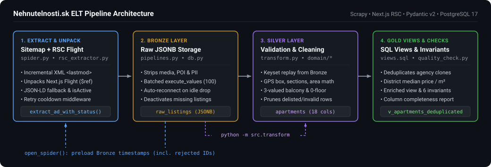
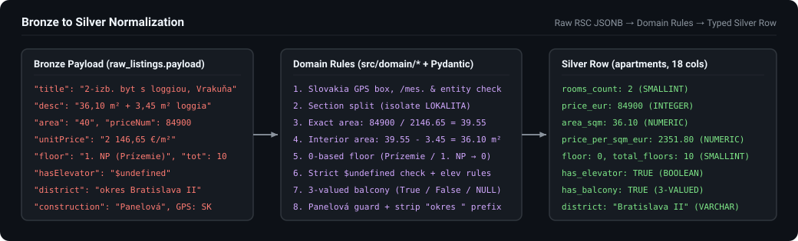

# nehnutelnosti.sk ELT Pipeline

[](https://github.com/1KIBORG1/data-pipeline/actions/workflows/ci.yml)


[](LICENSE)

Incremental ELT pipeline for scraping Slovak apartment sale listings from `nehnutelnosti.sk` into PostgreSQL 17 using Scrapy, Parsel, Pydantic v2, and psycopg2.



## Architecture

Data moves through three layers inside PostgreSQL 17:

| Layer | Object | Purpose |
| :--- | :--- | :--- |
| **Bronze** | `raw_listings` (`JSONB`) | Raw Next.js RSC payloads (with media/recommendation arrays stripped) plus `sitemap_lastmod`, `is_active`, `first_seen_at`, and `last_seen_at`. |
| **Silver** | `apartments` (18 columns) | Cleaned and validated apartment table rebuilt from active Bronze rows via `ApartmentModel`. |
| **Gold** | `v_apartments_deduplicated`, `v_district_price_summary` | Read-only SQL views for cross-agency deduplication (`ROW_NUMBER()`) and district median price/area summaries. |

Separating Bronze storage from Silver transformation lets parsing and validation rules be updated and re-applied across ~15,000 listings in a few seconds (`python -m src.transform`) without re-crawling the site.

## Pipeline Stages

### 1. Sitemap Crawl & RSC Extraction (`src/spider.py`, `src/rsc_extractor.py`, `src/pipelines.py`)
* `ApartmentSitemapSpider` reads `sitemap-listings-byty-predaj-slovensko.xml`.
* On startup, `BronzeRawPipeline.open_spider()` loads `{id: COALESCE(sitemap_lastmod, scraped_at)}` from `raw_listings` (including previously rejected or inactive IDs so they are not re-fetched on every run).
* Unchanged URLs are skipped by UTC timestamp comparison and have `last_seen_at` refreshed via `touch_seen_raw_listings()`.
* On full crawls (without `--limit`), listings missing from the sitemap are marked `is_active = FALSE`. Deactivation is skipped if the sitemap returns fewer than 20% of known listings to avoid wiping state on upstream failures.
* Listing pages use Next.js App Router RSC Flight streams (`self.__next_f.push(...)`). `src/rsc_extractor.py` unpacks the `advertisement` object, resolves out-of-line text chunks (`$ref` with UTF-8 byte lengths, falling back to JSON-LD), checks `isActive`, flags bot-challenge pages, and strips large UI fields before batched `execute_values` upserts.

### 2. Normalization & Validation (`src/transform.py`, `src/domain/`, `src/models.py`)
At the end of a crawl (unless `--bronze-only` is set), or standalone via `python -m src.transform`, active Bronze rows pass through `parse_apartment_desc_dict()` and `ApartmentModel`:



| Field / Rule | Raw Input Example | Output | Module (`src/domain/`) |
| :--- | :--- | :--- | :--- |
| **Scope & Entity Filter** | Non-SK GPS, `850 €/mes.`, houses, townhouses, buyer-wanted ads | Dropped | `classifier.py`: Slovakia WGS84 bounding box, `/mes.` rental check, 79 official Slovak districts, title/description/attribute filters. Reserved ads are kept by default (`--exclude-reserved` to drop). |
| **Description Sections** | `"LOKALITA: pri OC Terasa"` | Isolated from apartment text | `sections.py`: Splits Slovak descriptions by section headings (`LOKALITA`, `KONTAKT`, `BYTOVÝ DOM`, etc.) while keeping bulleted parameter lists intact. |
| **Interior Floor Area** | `area=40`, `priceNum=84900`, `unitPrice=2146.65`, `"36,10 m² + 3,45 m² loggia"` | `area_sqm = 36.10` | `area.py`: Recovers unrounded area from `priceNum / unitPrice`, repairs missing-decimal typos (`654` -> `65.4`) using unit-price bounds, and separates interior area from balcony/terrace/cellar totals. |
| **Room Count** | `"1-izbový prerobený na 2-izbový"` | `rooms_count = 2` | `rooms.py`: Priority order `title -> category_sub -> attribute -> description` (defers to `category_sub` on multi-unit ranges). |
| **Balcony (3-valued)** | `"nemá balkón, ale má terasu"` / `"spoločný balkón"` / omitted | `True` / `False` / `None` | `amenities.py`: Stem matching with Košice *Terasa* and planned-balcony exclusions. Keeps `NULL` when unspecified instead of defaulting to `FALSE`. |
| **Floor & Condition** | `"Prízemie"` / `"1. NP"`, `construction="Panelová"` | `floor = 0`, keeps `Pôvodný stav` | `floor_condition.py`: Maps ground-floor variants to `0`, guards panel/pre-2005 buildings against false `Novostavba` upgrades, and checks `hasElevator is True` explicitly (`"$undefined"` safe). |
| **District** | `"okres Bratislava II"` | `"Bratislava II"` | `reference.py`: Strips `"okres "` prefix and normalizes hyphen spacing. |

### 3. Data Quality Check (`src/quality_check.py`)
`python -m src.quality_check` prints Bronze/Silver/Gold row counts, column fill rates, `has_balcony` value breakdown, top districts, and verifies 6 invariants (exiting non-zero if any fail):
1. `price_per_sqm_eur` matches `ROUND(price_eur / area_sqm, 2)` within `0.05 EUR`
2. No `floor > total_floors`
3. No `total_floors <= 1`
4. Sale `price_per_sqm_eur` within `[300, 25000]`
5. `area_sqm` within `[10, 600]`
6. No `Panelová` listings marked `Novostavba` (Bronze joined with Silver)

## Notes on Design Choices
* **Single PostgreSQL instance for Bronze/Silver/Gold:** With ~15k active Slovak listings (~60 MB raw JSONB after stripping media/POIs), keyset pagination and batched upserts rebuild Silver in a few seconds without external object storage or distributed compute.
* **Three-valued `has_balcony` (`TRUE` / `FALSE` / `NULL`):** Unmentioned balconies are stored as `NULL` rather than `FALSE` so downstream price models do not conflate missing disclosure with confirmed absence.
* **Direct RSC extraction over headless browser:** Parsing `self.__next_f.push` directly gives typed portal fields (`priceNum`, `unitPrice`, GPS coordinates, `construction`, `isActive`) with much lower memory footprint than Playwright/Selenium.
* **CLI modules for scheduling:** `src.spider`, `src.transform`, and `src.quality_check` run as standalone container commands, making them simple to schedule via cron or wrap in Airflow/Prefect tasks later.

## Database Schema

Defined in [`sql/init_schema.sql`](sql/init_schema.sql) and [`sql/views.sql`](sql/views.sql). Silver `apartments` columns:

| Column | Type | Nullable | Description |
| :--- | :--- | :--- | :--- |
| `id` | `VARCHAR(32)` | `PRIMARY KEY` | Listing ID from URL (`Ju...`) |
| `url` | `TEXT` | `NOT NULL` | Listing detail URL |
| `title` | `TEXT` | `NULL` | Listing title |
| `transaction_type` | `VARCHAR(32)` | `NULL` | Normalized transaction type (`predaj`) |
| `category_sub` | `VARCHAR(64)` | `NULL` | Subcategory code (`ONE_ROOM_APARTMENT`, `STUDIO_APARTMENT`, etc.) |
| `rooms_count` | `SMALLINT` | `NULL` | Room count (`1..10`) |
| `price_eur` | `INTEGER` | `NULL` | Total price in EUR (`15,000..5,000,000`, `NULL` if omitted or out of bounds) |
| `price_per_sqm_eur` | `NUMERIC(10, 2)` | `NULL` | Unit price in EUR/$\text{m}^2$ (`ROUND(price_eur / area_sqm, 2)`) |
| `area_sqm` | `NUMERIC(8, 2)` | `NULL` | Interior floor area in $\text{m}^2$ (`10.0..600.0`) |
| `floor` | `SMALLINT` | `NULL` | Floor number (`-2..46`, `0` = ground floor) |
| `total_floors` | `SMALLINT` | `NULL` | Total floors in building (`> 1` and `>= floor`) |
| `property_condition` | `VARCHAR(64)` | `NULL` | Property condition (`Novostavba`, `Kompletná rekonštrukcia`, etc.) |
| `has_elevator` | `BOOLEAN` | `NOT NULL` | Elevator availability (`DEFAULT FALSE`) |
| `has_balcony` | `BOOLEAN` | `NULL` | Three-valued balcony/loggia/terrace flag (`TRUE`, `FALSE`, or `NULL`) |
| `city` | `VARCHAR(128)` | `NULL` | City or borough |
| `district` | `VARCHAR(128)` | `NULL` | Official Slovak district name without `"okres "` prefix |
| `updated_at` | `TIMESTAMPTZ` | `NULL` | Source modification timestamp |
| `scraped_at` | `TIMESTAMPTZ` | `NOT NULL` | Last upsert timestamp (`DEFAULT NOW()`) |

## Project Structure

```text
data-pipeline/
├── .github/workflows/ci.yml        # ruff, mypy, pytest + PostgreSQL 17 integration test
├── docs/
│   ├── architecture.svg
│   └── data_flow.svg
├── sql/
│   ├── init_schema.sql             # raw_listings + apartments + indexes
│   └── views.sql                   # v_apartments_deduplicated, v_district_price_summary
├── src/
│   ├── config.py                   # .env / DatabaseConfig
│   ├── db.py                       # psycopg2 persistence and batch upserts
│   ├── rsc_extractor.py            # Next.js RSC Flight HTML extractor
│   ├── parser.py                   # Raw field extraction from unpacked RSC dicts
│   ├── domain/
│   │   ├── reference.py            # 79 Slovak districts, GPS bounds, number/floor parsers
│   │   ├── sections.py             # Slovak description section splitter
│   │   ├── rooms.py                # Room count resolution
│   │   ├── amenities.py            # Balcony and elevator resolution
│   │   ├── floor_condition.py      # Floor indexing and property condition rules
│   │   ├── area.py                 # Portal area recovery and interior area decomposition
│   │   └── classifier.py           # Entity and geographic scope filters
│   ├── models.py                   # Pydantic v2 ApartmentModel
│   ├── pipelines.py                # BronzeRawPipeline (batched writes + Silver refresh)
│   ├── spider.py                   # Incremental Scrapy SitemapSpider CLI
│   ├── transform.py                # Offline Bronze -> Silver CLI
│   └── quality_check.py            # DB completeness and invariant check CLI
├── tests/
│   ├── test_contracts.py
│   ├── test_domain_extractors.py
│   ├── test_rsc_extractor.py
│   └── test_db_integration.py
├── .dockerignore
├── .env.example
├── Dockerfile
├── docker-compose.yml
├── LICENSE
├── pyproject.toml
└── requirements.txt
```

## Usage

### 1. Environment Variables
```bash
cp .env.example .env
```

```ini
DB_HOST=127.0.0.1
DB_PORT=5432
DB_EXTERNAL_PORT=5432
DB_NAME=nehnutelnosti
DB_USER=scraper
DB_PASSWORD=your_password
DB_SSLMODE=disable
```

Set `DB_EXTERNAL_PORT` (e.g. `5433` or `15432`) if host port `5432` is already in use.

### 2. Docker Compose
```bash
docker compose up -d db
docker compose build scraper

# Incremental crawl (Bronze ingest + Silver refresh)
docker compose run --rm scraper --speed fast

# Offline Bronze -> Silver rebuild (no network requests)
docker compose run --rm --entrypoint python scraper -m src.transform
docker compose run --rm --entrypoint python scraper -m src.transform --exclude-reserved

# Data quality report
docker compose run --rm --entrypoint python scraper -m src.quality_check
```

### 3. Local Development & Tests
```bash
python -m venv .venv
source .venv/bin/activate  # Windows: .\.venv\Scripts\activate
pip install -r requirements.txt

pytest
RUN_PG_INTEGRATION_TESTS=1 pytest  # requires running PostgreSQL 17

ruff check src tests
mypy src
```

### 4. Spider CLI Options

| Argument | Values | Default | Description |
| :--- | :--- | :--- | :--- |
| `--limit` | `int` | `None` | Max new/updated listings to queue (disables deactivation and Silver pruning) |
| `--speed` | `slow`, `normal`, `fast`, `turbo` | `normal` | Concurrency preset (`4`, `6`, `12`, or `24` concurrent requests) |
| `--workers` | `int` | `None` | Override `CONCURRENT_REQUESTS` and `CONCURRENT_REQUESTS_PER_DOMAIN` |
| `--log-level` | `DEBUG`, `INFO`, `WARNING`, `ERROR` | `INFO` | Logging verbosity |
| `--exclude-reserved` | `flag` | `False` | Exclude reserved (`rezervované`) listings during Silver refresh |
| `--bronze-only` | `flag` | `False` | Write to `raw_listings` only without running `src.transform` |

## License

[MIT](LICENSE)
